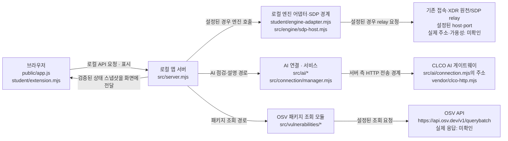

# 케셰브 학생 실행서 · 보안 Agent 21단계 초안

> 이 문서는 저장소 코드·기존 안내와 2026-11-11에 사용자가 직접 확인해 제공한 실행 기록을 구분합니다. 서버 시작 및 Chrome 화면 표시는 사용자가 확인했지만, 이번 문서 수정 과정에서는 서버를 다시 시작하지 않았습니다. 접근 제어·SDP/XDR·AI·OSV 외부 연결 성공은 확인되지 않았습니다.

## 1. 목적과 현재 코드 범위

케셰브(KESHEV)는 사용자가 자신의 로그인·기기·세션, 업무 앱 접근 판정, 접속 기록과 XDR 경보, AI 관련 안내를 확인하는 로컬 앱입니다. 현재 코드에는 패키지 취약점 조회 표시와 사용자가 확인하는 조치 흐름도 포함되어 있습니다. 앱을 실행하거나 이 UI가 존재한다는 사실만으로 기존 시스템 연결, AI 성공, 침해 여부 또는 보안 상태가 검증되는 것은 아닙니다.

화면과 API의 연결은 제공 코드가 담당하고, 학생 구현은 `student/extension.mjs`의 렌더 함수가 담당합니다. 기본 실행이 실제 회사 시스템에 연결되는 것으로 간주하지 않습니다. demo는 예제 자료이고, 운영 연결·권한은 별도 설정과 담당자 안내가 필요합니다.

## 2. 필요한 프로그램과 버전

| 구분 | 확인 내용 |
|---|---|
| Node.js 프로젝트 설정 | `package.json`의 `engines.node` 값은 정확히 `24.19.0`입니다. |
| 시작 스크립트 허용 범위 | `tools/start-alekov.ps1`은 Node.js 주 버전 22~24를 허용하고, `24.19.0`이 아니면 참고 문구를 냅니다. 기존 학생 실행 안내도 22~24, 수업 기준 24.19.0으로 설명합니다. 이 스크립트의 허용 범위와 package의 정확한 `engines` 값은 서로 다른 기준이며, 모든 조합을 시험했다는 뜻이 아닙니다. |
| 이 PC에 설치된 런타임 | 사용자가 확인한 Node.js `v26.13.0`은 설치되어 있지만, 시작 스크립트의 허용 범위 22~24 밖이므로 이 프로젝트의 지원 실행 버전이 아닙니다. |
| 문서 조사 중 읽은 npm | 앞선 읽기 전용 조사에서는 `npm.cmd --version`: `11.20.0`이었습니다. 그때 `npm --version`은 PowerShell 실행 정책으로 차단되어 `npm.cmd`로만 버전을 읽었습니다. 이 npm 버전이 아래 Node.js 24.19.0 ZIP 실행에 사용된 것인지는 확인되지 않았습니다. |
| 실제 시작 시 선택한 런타임 | 사용자가 Node.js `24.19.0` ZIP을 준비하고 현재 PowerShell PATH에서 선택한 뒤 앱을 시작했다고 확인했습니다. ZIP 준비·선택 과정을 이 문서 수정 중 다시 실행하지 않았습니다. 앞서 읽은 npm `11.20.0`이 이 ZIP 런타임과 함께 선택된 버전인지는 확인되지 않았습니다. |
| npm 의존성 | `package.json`에는 `dependencies` 또는 `devDependencies`가 없고 기존 README는 외부 npm 의존성이 없다고 설명합니다. 앱을 시작하기 위해 패키지를 설치할 필요가 있다는 근거는 확인되지 않았습니다. `on-client`에서 npm/yarn/pnpm lock 파일도 찾지 못했습니다. |
| 실행 셸 | Windows PowerShell. 아래 시작 명령은 `on-client` 폴더를 현재 작업 폴더로 열어 실행합니다. |

**주의:** 위의 실제 시작은 사용자가 선택한 Node.js 24.19.0에서 이루어졌습니다. 이는 해당 실행에서 사용된 버전의 기록이지, 모든 기능이나 연결이 검증됐다는 뜻은 아닙니다.

## 3. 폴더 위치와 실행

Git 저장소 최상위는 `on-client`의 상위 프로젝트 폴더입니다. 앱 파일과 아래 실행 스크립트는 `on-client`에 있습니다.

```text
케셰브-방어전/                  Git 저장소 최상위
└─ on-client/                   앱 폴더 · 시작 명령의 PowerShell 작업 폴더
   ├─ package.json
   ├─ README.md
   ├─ public/                   브라우저 화면 및 제공 UI
   ├─ src/                      로컬 앱 서버와 서버 모듈
   ├─ student/
   │  ├─ extension.mjs          학생 렌더 확장
   │  └─ engine-adapter.mjs      기존 엔진 연결 어댑터 경계
   ├─ tools/
   │  └─ start-alekov.ps1       학생용 실행 스크립트
   └─ docs/
      ├─ STUDENT_RUNBOOK.md
      ├─ STUDENT_LAUNCH_GUIDE.md
      └─ CONNECTION_TROUBLESHOOT.md
```

PowerShell의 현재 디렉터리를 다음 앱 폴더로 맞춘 뒤 실행합니다.

```text
C:\Users\yoo60\AppData\Local\ALEPH\Workbench\projects\케셰브-방어전\on-client
```

코드와 기존 [학생 실행 안내](STUDENT_LAUNCH_GUIDE.md)에 기록된 시작 명령:

```powershell
powershell -NoProfile -ExecutionPolicy Bypass -File .\tools\start-alekov.ps1
```

기본 포트 `5189` 및 서버의 `ON_PORT` 처리, 시작 도구의 `-Port` 전달은 코드에서 확인했습니다. 사용자가 제공한 실제 실행에서는 `5189` 포트 충돌이 발생했고, 기존 시작 도구 옵션을 사용해 포트 `5190`으로 실행했습니다. 같은 충돌이 난 경우의 명령은 다음과 같습니다.

```powershell
powershell -NoProfile -ExecutionPolicy Bypass -File .\tools\start-alekov.ps1 -Port 5190
```

실제 실행 시 기본 포트에서 충돌 메시지가 출력됐고, `5190`으로 바꾼 뒤 시작 도구가 서버 응답을 확인했다고 사용자가 보고했습니다. 이 문서 수정 중에는 명령을 재실행하지 않았습니다. 포트 변경 옵션의 출처와 추가 문제 안내는 [CONNECTION_TROUBLESHOOT.md](CONNECTION_TROUBLESHOOT.md)를 참고하세요.

기본 브라우저 주소:

```text
http://127.0.0.1:5189/
```

시작 스크립트의 `-Port` 옵션은 서버의 `ON_PORT`를 정합니다. 따라서 포트를 바꾸면 브라우저 주소의 포트도 같은 값으로 바꿔야 합니다. 예를 들어 `-Port 5190`이면 `http://127.0.0.1:5190/`입니다.

## 4. 시작·종료·재실행

사용자가 Node.js 24.19.0을 PATH에서 선택하고, `on-client` 폴더에서 `-Port 5190`으로 실행했을 때 보고한 로그입니다.

```text
케셰브 연결 확인: http://127.0.0.1:5190
케셰브가 켜졌습니다. 브라우저에서 http://127.0.0.1:5190/ 을 여세요.
서버가 응답한 것만 확인했습니다. AI 연결 상태는 화면에서 따로 확인해 주세요.
```

`케셰브 연결 확인`은 서버 소스의 시작 콜백 로그 형식이며, 시작 도구는 별도로 HTTP 응답을 확인한 뒤 다음 안내를 출력합니다. 사용자는 Chrome에서 `http://127.0.0.1:5190/` 화면 표시도 확인했습니다. 이 실행 성공은 **로컬 서버의 응답과 브라우저 화면 표시**까지입니다. 로그에 적힌 대로 기존 SDP 서버·에이전트, AI 또는 외부 보안 기능의 연결 성공을 뜻하지 않습니다.

사용자는 첫 실행에서 기본 포트 5189 충돌을 확인하고 5190으로 실행했으며, 이후 Ctrl+C로 서버를 종료한 뒤 재실행도 확인했습니다. 재실행 과정에는 서로 다른 두 관측이 있었습니다.

| 관측 | 사용자가 확인한 결과 |
|---|---|
| 앞선 재실행 시도 | 시작 안내가 출력된 뒤 PowerShell 프롬프트로 돌아왔고, 이후 HTTP 요청은 실패했으며 `Get-NetTCPConnection -LocalPort 5190 -State Listen`에서 수신 대기 항목이 없었습니다. 이는 당시의 일시 관측이며 종료 원인이나 구체적 원인은 확인되지 않았습니다. |
| 이후 재실행 | 아래 명령으로 정상 시작 로그가 출력되고 Chrome에서 `http://127.0.0.1:5190/` 화면이 표시된 것을 사용자가 확인했습니다. 이는 이전 실패 관측을 지우거나 원인을 설명하지 않습니다. |

```powershell
powershell -NoProfile -ExecutionPolicy Bypass -File .\tools\start-alekov.ps1 -Port 5190
```

사용자가 앞서 실제 시작 때 제공한 시작 안내는 다음과 같습니다. 이후 재실행에서도 정상 시작 로그가 출력됐다고 별도로 확인했으나, 재실행 로그 전문은 따로 제공되지 않았습니다.

```text
케셰브 연결 확인: http://127.0.0.1:5190
케셰브가 켜졌습니다. 브라우저에서 http://127.0.0.1:5190/ 을 여세요.
서버가 응답한 것만 확인했습니다. AI 연결 상태는 화면에서 따로 확인해 주세요.
```

해당 로그의 문구는 서버 응답 확인을 뜻할 뿐, SDP 엔진이나 AI 연결 성공을 뜻하지 않습니다. 앞선 HTTP 실패 및 Listen 부재의 원인은 확인되지 않았고, 이 문서 수정 과정에서는 서버를 시작·종료하지 않았습니다.

1. 시작 스크립트가 허용하는 Node.js 22~24인지 확인합니다. 이번 사용자는 Node.js 24.19.0을 선택했습니다.
2. PowerShell 작업 폴더가 `on-client`인지 확인합니다.
3. 기본 포트가 사용 중이면 사용자 확인 사례처럼 `-Port 5190`으로 시작합니다.
4. 로그가 안내한 포트 주소를 브라우저에서 엽니다. 이번 사용자는 5190 주소의 Chrome 화면 표시를 확인했습니다.
5. 사용자는 같은 PowerShell 창에서 `Ctrl+C`로 서버를 종료했다고 확인했습니다.
6. 사용자는 종료 후 같은 폴더에서 5190 시작 명령을 다시 실행했고, 이후 재실행에서 정상 시작 로그 및 Chrome 화면 표시를 확인했습니다. 앞선 재실행 시도에서는 HTTP 요청 실패와 Listen 항목 부재도 관측되었으며, 원인은 미확인입니다.

따라서 종료와 이후 재실행 성공은 사용자 제공 확인 사실입니다. 앞선 일시 실패 관측 또한 별도 사실로 보존하며, 재실행 성공이 그 원인을 밝혀 주지는 않습니다.

### 이번 실행의 엔진 연결 진단

사용자가 제공한 실행 사실은 다음과 같습니다.

- 시작 명령에 `-SdpHostConfig`를 지정하지 않았습니다.
- 확인한 PowerShell에서 `ON_ENGINE_ADAPTER` 환경변수가 설정되지 않았습니다.
- 상단에는 `연결 없음`이 표시되었고, 로그인 정보·업무 앱·보안 기록·기기·세션에는 `ENGINE_NOT_CONNECTED`와 다음 메시지가 표시되었습니다.

```text
기존 서버·에이전트의 연결을 확인할 수 없습니다. 연결 어댑터를 먼저 확인하세요.
```

[engine.mjs](../src/engine.mjs)는 선택된 엔진 경로가 없으면 미연결 엔진을 반환하고, 필요한 엔진 메서드가 없을 때 `ENGINE_NOT_CONNECTED`를 냅니다. [student/engine-adapter.mjs](../student/engine-adapter.mjs)의 기본 export도 `evidenceMode: 'disconnected'`입니다. [server.mjs](../src/server.mjs)는 `ON_ENGINE_ADAPTER` 또는 명시된 SDP 설정 경로에 따라 엔진을 선택합니다. 따라서 위 실행 조건은 관측된 엔진 오류와 일치합니다.

SDP host는 `-SdpHostConfig`/`--sdp-host-config`로 명시한 설정이 있을 때만 구성됩니다. 개인 설정과 자격 정보는 운영자의 승인된 발급 절차에서 받아야 하며 실제 프로젝트 폴더 밖에 두어야 합니다. `sdp-host.json`은 공식 필수 파일명이 아니라 사용자가 붙일 수 있는 임의 파일명이며, 공식 문서의 JSON은 형식 예시입니다. 설정이 없을 때 임의로 설정 파일이나 자격을 만들거나 인증을 우회하지 마세요. 공식 설정을 받지 못했다면 담당 운영자에게 발급 절차와 실제 설정 경로를 문의하세요. 인증서·키·토큰의 내용은 문서·대화·Git에 기록하지 않습니다.

이 관측만으로는 공식 SDP 설정이 발급되었는지, relay/agent가 동작하는지, 특정 네트워크·자격·응답 검증 단계에서 별도 실패가 있는지는 확인할 수 없습니다. `ENGINE_NOT_CONNECTED`는 기본 미연결 엔진에서 발생할 수도 있고, 명시된 SDP 엔진의 연결 실패에서도 나올 수 있으므로 오류 코드만으로 그 경우들을 구별하지 않습니다.

## 5. 구성과 데이터 흐름

아래는 파일에서 확인한 구성 경계입니다. 화살표는 코드의 호출·요청 경계를 요약하며, 실제 외부 연결 성공을 뜻하지 않습니다.



- `public/app.js`는 제공 UI의 요청·상태를 관리하고 `student/extension.mjs`의 렌더 함수를 슬롯에 연결합니다.
- `src/server.mjs`는 로컬 HTTP 경로를 제공하고 요청을 엔진·AI·취약점 조회 모듈에 전달합니다.
- 접근 제어 및 기록은 설정된 엔진 경계를 거칩니다. 서버는 `readEvents` 자료에서 `access`와 `xdr` 유형을 검증합니다. 연결 설정이 없거나 확인되지 않으면 실제 연동 상태는 미확인입니다.
- AI 서비스와 CLCO HTTP 전송은 서버 측 모듈 경계입니다. 브라우저에서 게이트웨이에 직접 연결하는 구성으로 설명하지 않습니다.
- 취약점 조회도 서버의 `/api/vulnerabilities` 경로와 프로젝트 스캐너를 통합니다. 이번 조사에서는 OSV에 요청하지 않았습니다.

## 6. 제공 코드와 학생 구현의 경계

| 영역 | 실제 파일·함수 | 역할 |
|---|---|---|
| 제공 브라우저 UI·요청 상태 | `public/app.js` | API 요청과 상태를 관리하고 학생 렌더 함수를 호출합니다. |
| 제공 서버·API 경계 | `src/server.mjs` | 로컬 HTTP 요청, 입력·응답 검증, 모듈 호출을 담당합니다. |
| 제공 공통 취약점 화면 | `public/vulnerabilities-view.mjs` | 패키지 조회 상태와 결과를 제공 UI에 표시합니다. |
| 학생 구현 | `student/extension.mjs`의 `renderIdentity` | 현재 사용자·기기·세션 상태와 연결 정보를 표시합니다. |
| 학생 구현 | `renderDecision` | 접근 판정 상태, 앱 ID, 판정·사유·시각과 실패 상태를 표시합니다. 허용 판정은 실제 앱 접속 성공과 구분합니다. |
| 학생 구현 | `renderEvents` | 접속·XDR 기록의 목록을 만들고 유형·시간 등으로 필터링하며 선택 기록의 상세를 표시합니다. |
| 학생 구현 | `renderStatus` | 기기·세션 상태, 알림, 진단 자료 상태와 실패 안내를 표시합니다. |
| 학생 구현 | `renderVulnerabilities` | 전체·패키지별 조회 상태와 정확한 버전, 출처·시각, 취약점 정보를 표시합니다. |
| 학생 구현 | `renderAiConnection` | AI 점검 상태·오류·권한 및 모델 확인 정보를 표시하고 연결 점검과 사건 설명을 구분합니다. |
| 학생 구현 | `renderExplanation` | 선택한 사건에 대한 설명·근거·제안의 표시를 처리하며 설명을 조치 실행으로 취급하지 않습니다. |
| 학생 구현 | `renderAction` | 현재 사건·조치의 확인, 실행 결과 및 결과 확인 불가 상태를 표시합니다. 소스상 별도의 사람 확인 및 서버 조치 흐름이 있으나 실제 조치 실행 여부는 확인하지 않았습니다. |

현재 `extension.mjs`에는 위 8개 렌더 함수가 있습니다. 제공 UI에서 받은 입력을 화면으로 표현하는 것이 학생 파일의 역할이며, 서버·인증 설정·연결 엔진 구현을 학생 렌더 함수의 책임으로 설명하지 않습니다.

## 7. 소스에서 확인되는 문제와 대응

다음 표는 소스 또는 기존 오류 안내에 실제로 나타나는 문구·코드만 추렸습니다. “다시 시도”는 UI가 안내하는 수동 절차이며, 자동 복구나 연결 성공을 보장하지 않습니다.

| 화면 문구·오류 | 확인 방법 | 문서에 기록된 대응 |
|---|---|---|
| `ENGINE_NOT_CONNECTED` / `기존 서버·에이전트의 연결을 확인할 수 없습니다. 연결 어댑터를 먼저 확인하세요.` | 상단 연결 상태와 해당 로그인·업무 앱·기록·기기·세션 영역의 오류를 확인합니다. 시작 명령에 `-SdpHostConfig`가 있었는지, 확인 가능한 환경에서 `ON_ENGINE_ADAPTER`가 설정됐는지 점검합니다. | 공식 SDP 설정·인증 정보는 운영자의 승인 발급 절차로 요청합니다. 자체 설정 파일 생성, 자격 추정, 인증 우회는 하지 않습니다. 이 오류만으로 설정 누락과 relay 장애를 구분할 수 없습니다. |
| `Node.js 가 없습니다` 또는 `지금 Node.js 는 vXX 입니다` | 실행 도구에서 Node 프로그램과 주 버전을 확인합니다. | 실행 도구 문서는 Node.js 22~24, 기준 24.19.0을 안내합니다. 이 PC의 Node.js 26.13.0은 설치되어 있지만 허용 범위 밖입니다. |
| `포트 5189 를 다른 프로그램이 쓰고 있습니다` | 메시지의 포트 번호와 시작 도구 결과를 확인합니다. | 기존 프로그램을 임의로 종료하지 말고, 문서에 있는 시작 도구의 `-Port 5190` 옵션을 사용합니다. 주소의 포트도 맞춰야 합니다. |
| `앱 폴더가 아닙니다`, `시작 틀 폴더가 아닙니다`, 바로가기/링크 경고 | 현재 PowerShell 작업 폴더와 실제 파일 위치를 확인합니다. | 실제 `on-client` 폴더에서 시작 명령을 실행합니다. |
| `앱 서버가 ... 초 안에 뜨지 않았습니다` | 실행 창의 전체 메시지를 확인합니다. 서버가 제한 시간 안에 응답하지 않은 상태입니다. | 기존 안내대로 메시지를 담당자에게 전달하고 원인을 확인합니다. 이 문서는 확인되지 않은 추가 복구 명령을 제안하지 않습니다. |
| 취약점 조회의 `패키지 조회 응답이 늦어 중단했습니다`, `패키지 조회 응답 형식을 확인할 수 없습니다`, `패키지 조회를 확인할 수 없습니다` | `public/vulnerabilities-view.mjs`의 시간 초과·계약 불일치·일반 실패 안내와 `student/extension.mjs`의 상태 렌더링을 확인합니다. | 조회 결과 없음이나 안전으로 해석하지 않습니다. 원인 해결 후 제공 UI의 `설치 패키지 조회`로 직접 다시 요청할 수 있습니다. 실제 OSV 응답은 미확인입니다. |
| AI 코드 `ON_AI_PROVISIONING_PENDING`, `WB_CLCO_AUTH_REQUIRED`, `WB_CLCO_ACCESS_BLOCKED`, `WB_CLCO_TIMEOUT`, `WB_CLCO_NETWORK_ERROR`, `WB_CLCO_SERVER_UNAVAILABLE` | AI 연결 점검 칸의 코드와 [연결 문제 해결 안내](CONNECTION_TROUBLESHOOT.md)를 확인합니다. | 기존 안내대로 담당자의 권한·준비 상태 확인 또는 네트워크·서비스 안내 확인 후, 필요하면 제공 UI의 `AI 연결 점검`을 직접 요청합니다. 비밀값을 공유하지 않습니다. |
| 기록 오류 `CONTRACT_MISMATCH`, `ENGINE_RESULT_UNVERIFIED`, `SUBJECT_SCOPE_UNVERIFIED` | 오류 코드와 제공된 도움정보를 확인합니다. | 기존 안내는 검증 불가 결과를 정상으로 간주하지 않고, 필요하면 다시 불러오거나 담당자에게 확인하도록 합니다. 실제 SDP/XDR 연결 여부는 이 조사에서 확인하지 않았습니다. |

오류 메시지는 상황·버전에 따라 다를 수 있습니다. 위 표는 전체 오류 목록이 아니며, 비밀값·환경 설정 내용은 이 문서에 포함하지 않습니다.

## 8. 확인 수준과 지원 범위

### 직접 확인된 것

- 사용자가 Node.js 24.19.0 ZIP을 현재 PowerShell PATH에서 선택했다고 확인했습니다.
- 사용자가 기본 5189 포트 충돌 메시지를 확인했고 `-Port 5190`으로 시작했다고 보고했습니다.
- 사용자가 다음 시작 로그와 Chrome 화면 표시를 확인했다고 보고했습니다.
- 사용자가 `Ctrl+C`로 종료한 뒤 5190 재실행을 확인했습니다. 한 번의 재실행에서는 시작 안내 뒤 HTTP 요청 실패 및 Listen 항목 부재가 있었고, 이후 재실행에서는 정상 로그와 Chrome 화면 표시가 확인됐습니다. 앞선 실패의 원인은 미확인입니다.
- 사용자가 상단 `연결 없음` 및 다섯 데이터 영역의 `ENGINE_NOT_CONNECTED` 메시지를 확인했다고 보고했습니다.
- 실제 시작 명령에 `-SdpHostConfig`가 없었고 확인한 PowerShell에 `ON_ENGINE_ADAPTER`가 설정되지 않았다고 보고했습니다.
- `sdp-host.json`이 `on-client`에 없었다고 보고했습니다. 문서상 이 이름은 필수 파일명이 아닙니다.

- 앞선 읽기 전용 조사에서 `node v26.13.0`, `npm.cmd 11.20.0`을 확인했습니다. 사용자가 제공한 정보상 Node.js 26.13.0은 이 PC에 설치되어 있지만 프로젝트 지원 범위 밖이며, npm 11.20.0이 Node.js 24.19.0 ZIP과 함께 선택됐는지는 확인되지 않았습니다.
- `package.json`, 시작 도구, 서버·UI·학생 파일과 SDP 연결 문서의 내용을 소스 읽기로 확인했습니다. 실제 실행 사실과 소스상 계약은 아래에서 따로 구분합니다.

### 코드·문서에서만 확인한 기대 동작

- Node.js 주 버전 22~24 허용 검사, 프로젝트의 `24.19.0` engines 값, 기본 포트 `5189`.
- 시작 스크립트의 `-Port`에서 `ON_PORT`로의 전달, SDP relay 요청 및 서버 측 AI/OSV 전송 경계.
- 브라우저·서버·엔진·AI·취약점 모듈 사이의 코드 경계와 8개 학생 렌더 함수의 역할.
- `-SdpHostConfig`를 주지 않고 `ON_ENGINE_ADAPTER`도 설정하지 않은 조건에서는 기본 어댑터가 미연결인 코드 경로.

### 미확인

- 앞선 재실행 시도의 HTTP 실패 및 Listen 항목 부재 원인. 이후 재실행 성공이 그 원인을 설명하지는 않습니다.
- 공식 SDP 설정·인증 정보가 발급되었는지, 외부 SDP relay/agent의 가용성, 실제 접근 제어 판정, 실제 SDP/XDR 연결.
- 실제 AI 게이트웨이 연결 또는 모델 응답. 사용자는 AI 연결 점검을 실행하지 않았습니다.
- 실제 OSV API 응답, 패키지 취약점 결과, 조치가 외부 시스템에서 수행되는지 여부.
- Node.js 22~24 각 버전에서의 호환성 전체 및 이 프로젝트의 기능별 전체 테스트.
- 공식 21단계 제출·검수 결과.

저장소의 `docs/CURRICULUM.json`은 21단계 기준 상태를 `proposal`, 실행 상태를 `planned_not_verified`로 표시하며, 자동 확인 ID는 4개입니다. `docs/STUDENT_PROMPTS.md`의 21단계 본문은 설명서 필수 내용을 5개로 나열합니다. 이 저장소 자료에는 별도의 공식 6개 항목 목록이 없으므로, 이 실행서는 공식 완료 판정을 주장하지 않습니다.

따라서 사용자가 확인한 성공 사례는 **로컬 앱 서버 시작, Ctrl+C 종료, 이후 재실행 및 브라우저 화면 표시까지**입니다. 앞선 재실행 실패 관측도 별도 기록으로 남깁니다. 기존 서버·에이전트 연결, AI, XDR, OSV 또는 실제 외부 보안 조치 성공으로 확대 해석하지 않습니다.
